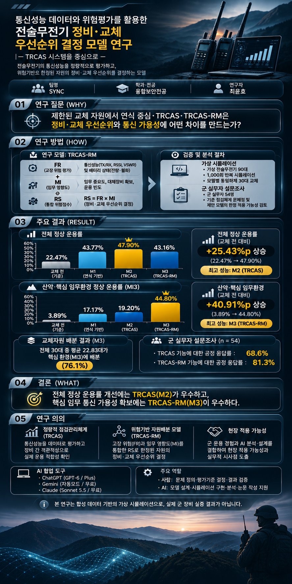

# AI MULTIMEDIA PROJECT

## 통신성능 데이터와 위험평가를 활용한 전술무전기 정비·교체 우선순위 결정 모델 연구

### ― TRCAS 시스템을 중심으로 ―

---

## 1. 제작자 정보

- 성명: 최윤호
- 소속: 한세대학교 융합보안학과
- 작품 유형: AI 기반 연구 인포그래픽
- 활용 주제: TRCAS 및 TRCAS-RM 시스템

---

## 2. 작품 소개

본 작품은 전술무전기의 통신성능을 정량적으로 평가하고,
위험평가를 기반으로 정비·교체 우선순위를 결정하는
TRCAS 및 TRCAS-RM 시스템의 연구 내용을 시각화한
AI 기반 멀티미디어 작품이다.

---

## 3. 제작 의도

기존에 진행한 연구의 목적, 방법, 결과 및 의의를
문자, 이미지, 그래프 등의 멀티미디어 요소를 결합하여
효과적으로 전달하고자 제작하였다.

또한 국방 기술과 생성형 AI의 융합 가능성을 표현하고,
복잡한 연구 내용을 직관적으로 이해할 수 있도록 구성하였다.

---

## 4. 활용 AI 도구

### 연구 및 분석

- ChatGPT
- Google Gemini
- Claude

### 멀티미디어 제작

- ChatGPT 이미지 생성 AI

---

## 5. 프롬프트 구성

연구 내용을 바탕으로 다음과 같은 요구사항을
AI에 전달하여 작품을 제작하였다.

- 딥 네이비 색상의 국방 기술 연구 배너 제작
- 전술무전기와 산악 환경을 활용한 배경 구성
- 연구 질문, 연구 방법, 주요 결과, 결론 및 연구 의의 구분
- 정량적 연구 결과를 그래프와 수치로 시각화
- 핵심 연구 결과에 대한 색상 강조
- 전문적인 방위산업 기술 소개 자료 형태로 구성

---

## 6. 작품 제작 과정

1. 기존 TRCAS 및 TRCAS-RM 연구자료 분석
2. 배너에 포함할 핵심 연구 내용 선정
3. 디자인 방향 및 이미지 생성 프롬프트 작성
4. 생성형 AI를 활용한 배너 이미지 제작
5. 연구 수치 및 그래프의 정확성 검토
6. 추가 프롬프트를 통한 디자인 및 문구 수정
7. 개인정보 제거 및 최종 작품 완성

제작 과정에서 연구자는 핵심 내용 선정, 디자인 방향 설정,
결과 검증 및 수정 사항 결정을 담당하였으며,
AI는 이미지 생성과 시각적 구성을 지원하였다.

---

## 7. 최종 멀티미디어 작품

---

## 8. 제작 소감

생성형 AI를 활용하여 복잡한 연구 내용과 정량적 데이터를
시각적으로 표현할 수 있었다.

문자, 이미지, 그래프를 결합함으로써 정보 전달의 효과를
높일 수 있었으며, AI 생성 결과물의 정확성과 완성도를
확보하기 위해서는 인간의 판단과 지속적인 검증이
중요하다는 것을 느꼈다.

---

※ 본 연구는 합성 데이터 기반의 가상 시뮬레이션으로,
실제 군 장비의 실증 결과가 아닙니다.
